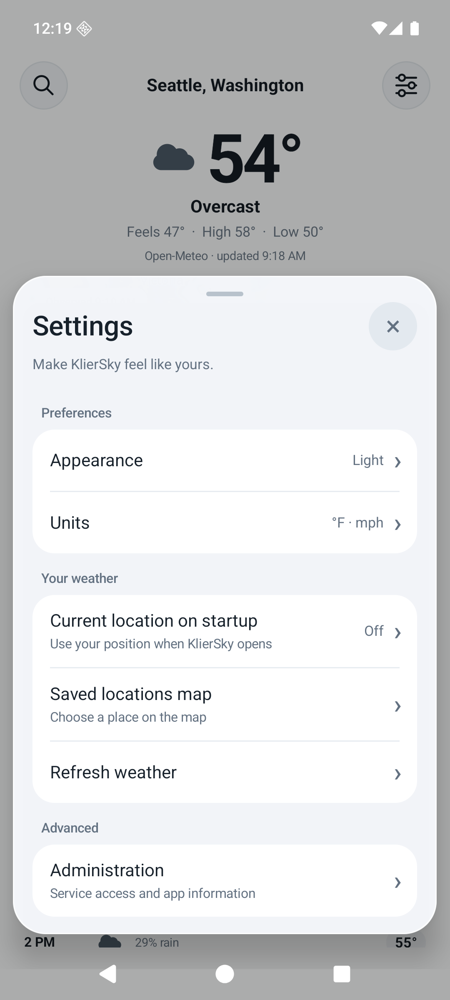
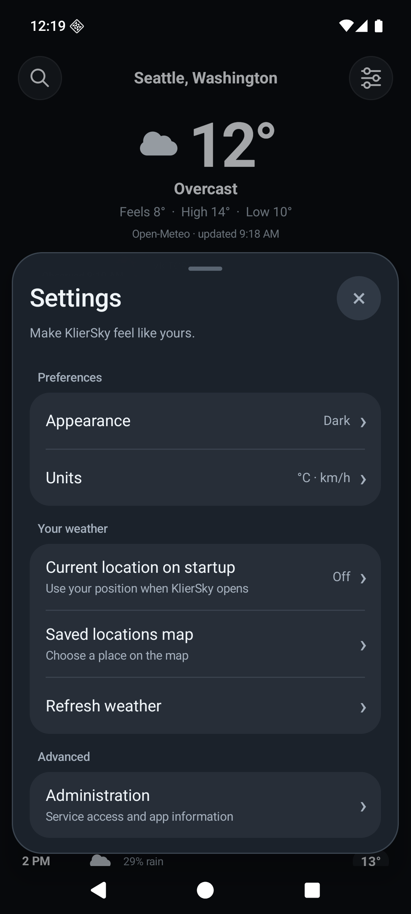
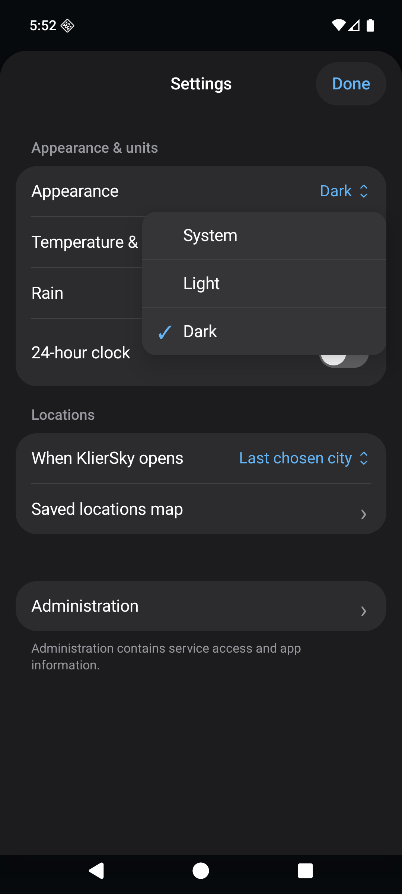
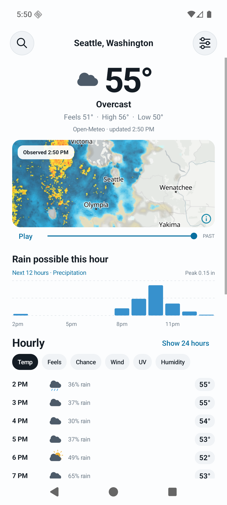
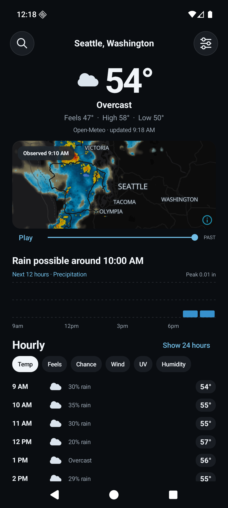
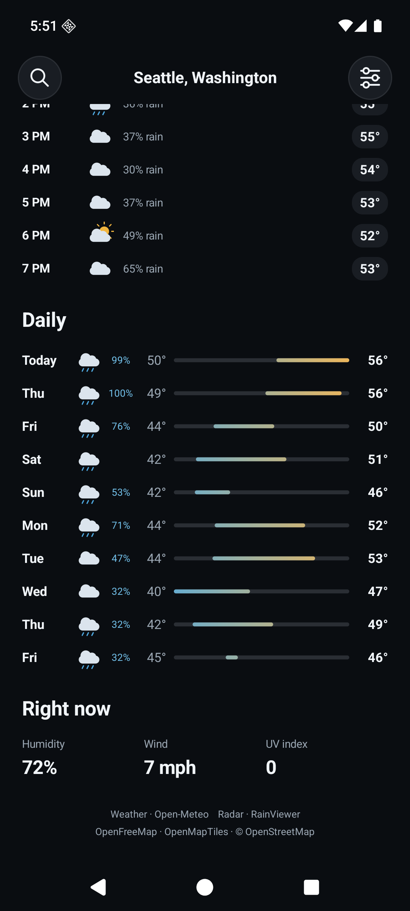

# KlierSky Android alpha

A native Android preview with system typography and the KlierSky name, built from the same provider contracts as the iPhone app. The application ID is `com.klier.kliersky`, version `0.1.3-alpha`.

Includes current conditions, feels-like temperature, compact hourly and daily forecasts, UV/humidity forecast readings, current-location permission with a saved-city fallback, city search, persistent favorites, saved-place map selection, light/dark/system appearance, units, and a MapLibre observed-radar timeline. Foreca is used through the existing HTTPS gateway when this device has owner-approved read-only access. The Foreca credential stays on the server. The encrypted device credential is backed by Android Keystore. Open-Meteo supplies the labeled fallback.

The iOS weighted blend, model futurecast, historical comparison, personal-station setup, rain reminders and widgets still need Android ports. This alpha has build, lint, signature and bundle-format checks. The live forecast UI was exercised on a Pixel 7 Android 16 emulator, including city search, light → dark → light changes, humidity selection, six/24-hour expansion and MapLibre rendering. Physical-device radar performance, location permission and live Foreca enrollment still need testing.

## Install the alpha

[Install APK](https://github.com/gklier/KlierSky/releases/download/android-v0.1.3-alpha/KlierSky-Android-0.1.3-alpha.apk) · [Download AAB](https://github.com/gklier/KlierSky/releases/download/android-v0.1.3-alpha/KlierSky-Android-0.1.3-alpha.aab) · [Release notes and checksums](https://github.com/gklier/KlierSky/releases/tag/android-v0.1.3-alpha)

Use the APK on an Android phone. Install over the existing alpha to retain data; the package and signing certificate are unchanged. The AAB is for publishing, not direct installation.

## Settings aligned with the iPhone app

Version 0.1.3 uses the actual iPhone settings screenshot as its reference. Settings now opens in one tall panel with a centered inline title, Done control, compact grouped rows, matching dark/light surface colors and blue preference values. Appearance, temperature/wind, rain units and startup location open small anchored menus instead of separate bottom sheets. Administration navigates within the same panel, with Back and Done controls.

Rain units are independent of temperature/wind units; the new 24-hour clock control changes forecast, chart and radar time formatting. Preferences persist, and existing rain-unit behavior is preserved on upgrade. Android system typography is retained; no Apple fonts or assets are bundled. Unsupported iOS-only features remain excluded from the normal settings form.

<p align="center">
  
  
  
</p>

Emulator UI checks cover theme changes while keeping Settings open, anchored choices, independent rain units, clock mode, startup location and Administration navigation. Locations and forecast details continue to use the rounded sheets added in 0.1.2.

## Design update

Version 0.1.1 replaces the first alpha's oversized controls with a compact current/map/outlook/hourly/daily hierarchy, native system typography, original weather symbols, colored rain/wind charts, temperature ranges and readable light/dark themes. Hourly metrics update without rebuilding the map. Radar retains a clear observed timestamp and past-only timeline; the separate 12-hour chart is a forecast.

These are live Android emulator captures, not mockups:

<p align="center">
  
  
  
</p>

## Build

Requires JDK 17, Android SDK platform 36 and build tools 36.0.0. Set `sdk.dir` in an untracked `local.properties`, or use `ANDROID_HOME`.

```
./gradlew :app:bundleDebug :app:assembleDebug
```

For a signed release, set `KLIERSKY_KEYSTORE_PATH`, `KLIERSKY_STORE_PASSWORD` and `KLIERSKY_KEY_PASSWORD` in the build environment. The upload-key alias is `kliersky-upload`. Keep the keystore and credentials in private storage outside this checkout.

```
./gradlew :app:bundleRelease :app:assembleRelease :app:lintRelease
```

The AAB is a publishing bundle. Use the companion APK for direct installation on an Android phone. Google Play listing, enrollment, app signing configuration and review remain separate owner steps.

## Data and attribution

Foreca service access uses the owner's existing entitlement. Open-Meteo's free endpoint is for non-commercial use. RainViewer supplies observed radar frames. OpenFreeMap uses OpenMapTiles and OpenStreetMap data. Native MapLibre retains its attribution control. See the repository's provider notes and the respective provider terms before distributing beyond personal testing.
