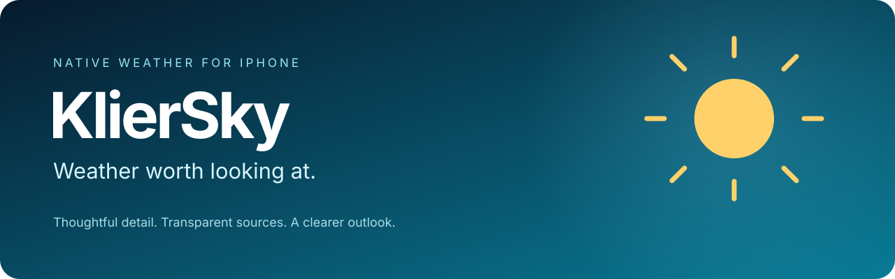
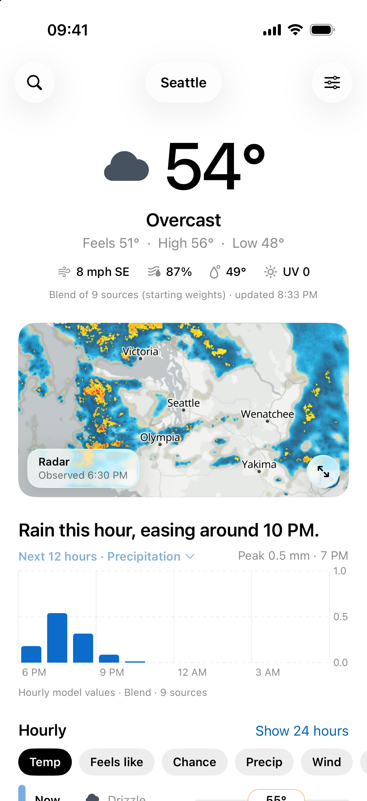
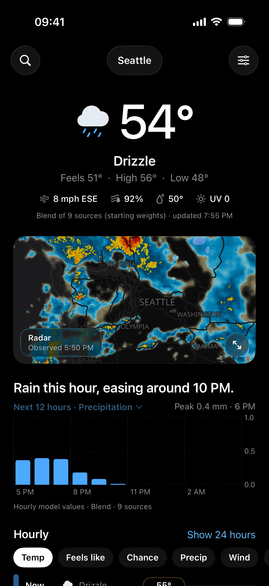
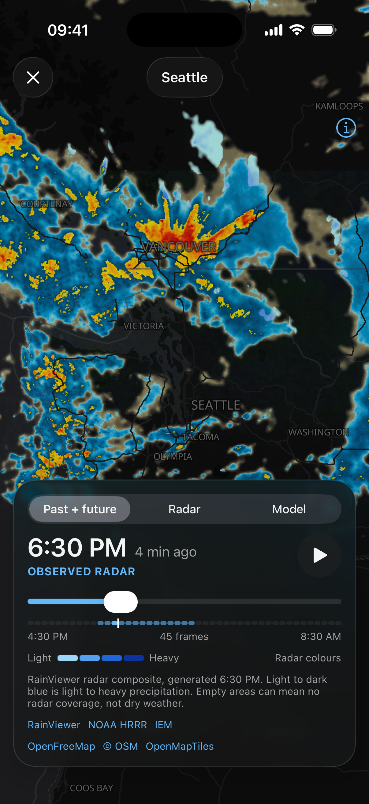
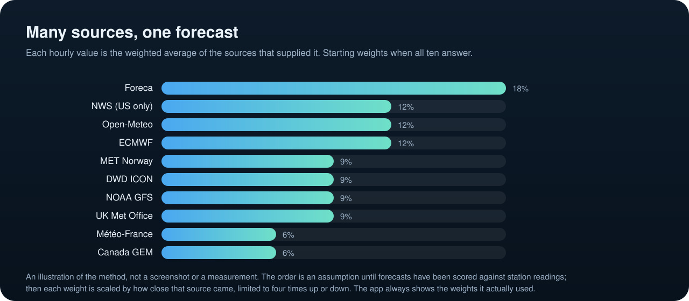

<div align="center">



**A compact, native iPhone weather app with a little nostalgia and a clearer outlook.**

SwiftUI · MapLibre Native · WidgetKit · Foreca · Open-Meteo

[](#build-it)
[](LICENSE.md)
[](#where-things-stand)
[](https://buymeacoffee.com/gklier)

[The app](#a-forecast-you-can-read-at-a-glance) · [Screenshots](#a-look-inside) · [Coming next](#in-development-many-sources-one-forecast) · [Build your own](#build-it) · [Roadmap](#what-comes-next) · [Support](#support-kliersky)

</div>

## A forecast you can read at a glance

KlierSky brings the dense, useful feel of classic weather apps to a native SwiftUI interface. Current conditions come first, followed by the map, a meaningful 12-hour outlook, compact hourly rows, daily forecasts and deeper weather details.

The design takes inspiration from what made Dark Sky easy to read, using original code and artwork, Apple system typography, and light, dark or system appearance. KlierSky is an independent project and is not affiliated with Apple or Dark Sky.

## A look inside

<table>
<tr><th>Clear in daylight</th><th>Comfortable after dark</th><th>From radar to futurecast</th></tr>
<tr>
<td width="33%"></td>
<td width="33%"></td>
<td width="33%"></td>
</tr>
</table>

*Actual iPhone simulator captures from KlierSky 0.4.0, November 10, 2026. Weather values are snapshots. Forecast sources and map timestamps are visible in the app.*

## In development: many sources, one forecast



The next version averages many weather services instead of trusting one: Foreca when connected, Open-Meteo, six global weather models, MET Norway and, in the US, the National Weather Service. More reliable sources count for more, and the app shows which took part and with what weight. Alongside it come a past-to-future map timeline, hourly and daily widgets, and widgets that keep updating without reopening the app.

This is **not in the code on this page yet**. It lives on the [`development/cloud-continuation`](https://github.com/gklier/KlierSky/tree/development/cloud-continuation) branch ([pull request](https://github.com/gklier/KlierSky/pull/1)) and has been tested against recorded and live responses, and the 0.4.0 development build has run in the iPhone simulator. The weights start as a fixed ranking, not a measurement, and no accuracy gain is claimed.

## Made for everyday weather

| Feature | What it does |
| --- | --- |
| **Conditions first** | Temperature, feels-like conditions and wind without burying the essentials. |
| **Interactive radar** | Native MapLibre map with observed precipitation, playback and scrubbing. |
| **A useful 12-hour graph** | Rain amounts or rain chance when relevant; a wind outlook when a complete dry forecast is available. Missing data stays missing. |
| **Compact hours, expandable detail** | Six hourly rows at a glance, expandable to 24. |
| **Daily forecasts** | Up to 14 days with day-by-day precipitation, wind, UV and sun details where returned by the provider. |
| **Your places** | Current-location default, city search and persistent favorite locations. |
| **Widgets** | Home Screen and Lock Screen WidgetKit families with city and unit configuration. |
| **Your preferences** | Light/dark/system theme, units, clock format and visible weather details. |
| **Honest data** | Source labels, cached-forecast notices, update times and unavailable values. |
| **Weather Lab** | Gateway setup, provider preferences and bounded local diagnostic export. |

## Adaptive weather, with evidence

KlierSky records forecasts before their target times and can compare temperatures against independent nearby US weather-station observations. It ranks providers separately by location and forecast lead time.

Temperature selection requires **at least 20 common target hours** and a **0.5°F mean absolute error advantage**. Until then, the preferred provider stays in use. Verification is opt-in and currently runs while the app refreshes; it is not yet an always-on learning service.

This is experimental **temperature selection**, not a claim that KlierSky is more accurate. Precipitation calibration and continuous server-side verification remain on the roadmap. [Read the feature status →](Docs/FEATURE-STATUS.md)

## Where things stand

| Area | Current status |
| --- | --- |
| Main forecasts | Foreca through a configured private gateway; explicitly labeled Open-Meteo comparison/fallback. |
| Radar | Real observed RainViewer imagery. Animation performance still needs measured device profiling and tile prebuffering. |
| Futurecast maps | Adapter and signed-tile gateway implemented; **not active with point-only Foreca access**. Licensed map access and live validation are still required. |
| Widgets | Implemented and build-validated. Currently fetch Open-Meteo independently; shared Foreca data and full widget QA are pending. |
| SideStore | Release packaging prepared; owner installation/refresh verification is pending. No App Store or TestFlight release. |
| Adaptive selection | Implemented with evidence gates. No measured accuracy advantage established. |

**Observed radar is never presented as futurecast.** A 12-hour point precipitation graph is not a 12-hour forecast map. We preserve that distinction throughout the project.

## Build it

You can build and run your own copy for personal and noncommercial use ([license](LICENSE.md)): no paid account, weather key or server needed. A Mac with Xcode and an iPhone (or the simulator) is enough.

```sh
git clone https://github.com/gklier/KlierSky.git
cd KlierSky
open KlierSky.xcodeproj
```

Choose your own signing team and bundle identifiers on both targets, then press Run. **[Full guide: build, install through SideStore, optional Foreca gateway →](Docs/BUILD-AND-INSTALL.md)**

Open-Meteo forecasts and observed radar work without a Foreca key. Provider terms and service availability still apply. No personal server endpoint or credential is bundled in this repository.

### Checks

```sh
sh Tests/run.sh
```

Portable Swift checks cover data decoding, provenance, stale data, timeline selection and adaptive verification safeguards. Python tests cover gateway normalization, missing values, pairing, signatures and map entitlement handling. Recorded fixtures are test inputs, not synthetic weather shown in the app.

## Under the hood

| Component | Responsibility |
| --- | --- |
| `Weather.swift` | Forecast models, provider requests and actual-frame timeline selection. |
| `ContentView.swift` / `ForecastDetails.swift` | Refresh coordination, compact UI and daily details. |
| `RadarView.swift` | Native MapLibre weather layers and timeline interaction. |
| `AppServices.swift` | Keychain, cache, diagnostics, favorites and location support. |
| `AdaptiveCore.swift` / `AdaptiveStore.swift` | Forecast capture, independent verification and guarded selection. |
| `KlierSkyWidgets/` | Home Screen and Lock Screen widgets. |
| `Gateway/` | Server-side Foreca integration and authenticated/signed map proxy. |

## What comes next

- [ ] Verify SideStore install, migration, widgets and refresh on a physical iPhone.
- [ ] Activate and validate legitimate 12+ hour forecast maps with licensed access.
- [ ] Add severe-weather alerts and reliable notification delivery.
- [ ] Add genuine near-term rain timing where supported.
- [ ] Collect and verify adaptive forecasts continuously on the server.
- [ ] Share Foreca forecasts with widgets.
- [ ] Add read-only per-device family access and revocation.
- [ ] Profile radar, battery and memory; complete accessibility and offline testing.

## Privacy and data sources

Foreca vendor credentials stay on the user's server; the iPhone stores a gateway access token in Keychain. Location is sent to the relevant weather/geocoding providers to obtain local results. Diagnostic messages are bounded, local and sanitized; nothing is uploaded automatically. Adaptive history stays on the device in the current implementation. This is not a claim of zero third-party network traffic.

Credits: [Foreca](https://developer.foreca.com/), [Open-Meteo](https://open-meteo.com/), [RainViewer](https://www.rainviewer.com/), [MapLibre Native](https://maplibre.org/), [OpenFreeMap](https://openfreemap.org/), [OpenStreetMap contributors](https://www.openstreetmap.org/copyright) and OpenMapTiles. Provider licenses, attribution, quotas and redistribution rights apply independently of this repository. See [project and third-party notices](NOTICE.md). [Provider notes →](Docs/PROVIDERS.md)

## Support KlierSky

If you'd like to help cover development and weather-data costs, a coffee is appreciated. Support is optional; it does not promise delivery dates or forecast accuracy.

<a href="https://buymeacoffee.com/gklier"></a>

Found a bug or have a useful idea? [Open an issue](https://github.com/gklier/KlierSky/issues). Include the app version, source label and steps to reproduce. Keep API keys, gateway tokens, pairing codes and private location logs out of reports.

---

<div align="center"><sub>Built by gklier · Early beta · Original design and implementation</sub></div>
