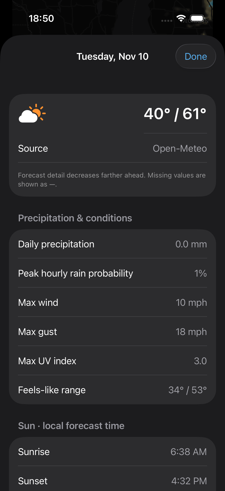

<div align="center">


**A compact, native iPhone weather app with a little nostalgia and a clearer outlook.**

SwiftUI · MapLibre Native · Foreca · Open-Meteo · WidgetKit

[](#build-it)
[](#where-things-stand)
[](https://buymeacoffee.com/gklier)

[The app](#a-forecast-you-can-read-at-a-glance) · [Screenshots](#a-look-inside) · [Build](#build-it) · [Roadmap](#what-comes-next) · [Support](#support-kliersky)

</div>

## A forecast you can read at a glance

KlierSky brings the dense, useful feel of classic weather apps to a native SwiftUI interface. Current conditions come first, followed by the map, a meaningful 12-hour outlook, compact hourly rows, daily forecasts and deeper weather details.

The design takes inspiration from what made Dark Sky easy to read, using original code and artwork, Apple system typography, and light, dark or system appearance. KlierSky is an independent project and is not affiliated with Apple or Dark Sky.

## A look inside

<table>
<tr><th>Clear in daylight</th><th>Comfortable after dark</th><th>The details behind the day</th></tr>
<tr>
<td width="33%"></td>
<td width="33%"></td>
<td width="33%"></td>
</tr>
</table>

*Actual simulator captures from the development app, November 9, 2026. They predate later interface changes on the development branch, so the current layout differs in places. These screenshots use Open-Meteo; sources and timestamps remain visible. Weather values are snapshots, not current conditions. No generated app mockups.*

## Made for everyday weather

| Feature | What it does |
| --- | --- |
| **Conditions first** | Temperature, feels-like conditions and wind without burying the essentials. |
| **Interactive radar** | Native MapLibre map with observed precipitation, playback and scrubbing. |
| **A useful 12-hour graph** | Rain amounts or rain chance when relevant; a wind outlook when a complete dry forecast is available. Missing data stays missing. |
| **Compact hours, expandable detail** | Six hourly rows at a glance, expandable to 24. |
| **Daily forecasts** | Up to 14 days with day-by-day precipitation, wind, UV and sun details where returned by the provider. |
| **Your places** | Current-location default, city search and persistent favorite locations. |
| **Widgets** | Home Screen and Lock Screen WidgetKit families with city and unit configuration. |
| **Your preferences** | Light/dark/system theme, units, clock format and visible weather details. |
| **Honest data** | Source labels, cached-forecast notices, update times and unavailable values. |
| **Weather Lab** | Gateway setup, provider preferences and bounded local diagnostic export. |

## Adaptive weather, with evidence

KlierSky records forecasts before their target times and can compare temperatures against independent nearby US weather-station observations. It ranks providers separately by location and forecast lead time.

Temperature selection requires **at least 20 common target hours across 5 or more days**, a **0.5°F mean absolute error advantage**, and a held-out check on later hours. Until then, the preferred provider stays in use. Verification is opt-in and runs while the app refreshes (plus best-effort background refresh); it is not an always-on learning service.

This is experimental **temperature selection**, not a claim that KlierSky is more accurate. Precipitation calibration and continuous server-side verification remain on the roadmap. [Read the feature status →](Docs/FEATURE-STATUS.md)

## Where things stand

| Area | Current status |
| --- | --- |
| Main forecasts | Foreca through a configured private gateway; explicitly labeled Open-Meteo comparison/fallback. |
| Radar | Real observed RainViewer imagery. Animation performance still needs measured device profiling and tile prebuffering. |
| Futurecast maps | Development branch: NOAA HRRR model reflectivity for the contiguous US via Iowa Environmental Mesonet tiles, checked live at roughly 14 to 16 hours of look-ahead; not yet built or verified on a device. Foreca map adapter exists but is **not active with point-only Foreca access**. |
| Alerts | Development branch: US National Weather Service alerts listed in the app. Not push notifications. |
| Device access | Development branch: automatic per-device read-only gateway access with approval, quotas and revocation; tested, **not deployed**. |
| Widgets | Implemented; the last simulator build predates the latest branch changes. Fetch Open-Meteo independently and say so; shared Foreca data and full widget QA are pending. |
| SideStore | 0.3.1 (7) is the installed owner release. Development source is 0.4.0 (8), not yet built or packaged. No App Store or TestFlight release. |
| Adaptive selection | Implemented with evidence gates. No measured accuracy advantage established. |

**Observed radar is never presented as futurecast.** A 12-hour point precipitation graph is not a 12-hour forecast map. We preserve that distinction throughout the project.

## Build it

Requirements: a Mac with Xcode and an iOS 17+ device or compatible simulator. Development validation used Xcode 27.2. The official MapLibre dependency is pinned in the project.

```sh
git clone https://github.com/gklier/KlierSky.git
cd KlierSky
open KlierSky.xcodeproj
```

1. Let Xcode resolve the MapLibre package.
2. Select the **KlierSky** scheme and a simulator. For a real device, select your own signing team for both the app and widget targets; adjust bundle identifiers if needed.
3. Run. Open-Meteo and observed radar can work without a Foreca key. Provider terms and service availability still apply.
4. For Foreca, deploy your own HTTPS gateway and give the build its address through the `KLIERSKY_GATEWAY_URL` build setting (see `Config/Local.example.xcconfig`), or enter it under **Settings → Owner administration**. No personal server endpoint or credential is bundled in this repository. [Gateway setup →](Gateway/README.md)

SideStore can re-sign an IPA using the tester's own account. Free signing requires periodic refreshes and has app/App ID limits. Keep an existing installation when importing an update to avoid unnecessary data loss. [Official SideStore instructions](https://docs.sidestore.io/docs/installation/install)

### Checks

```sh
sh Tests/run.sh
```

Portable Swift checks cover data decoding, provider switching and labels, stale data, timeline selection, radar buffering, alerts, device-access states and adaptive verification safeguards. Python tests cover gateway normalization, missing values, pairing, signatures, map entitlement handling and per-device access. They run on macOS and on Linux with a Swift toolchain. Recorded fixtures are test inputs, not synthetic weather shown in the app.

`sh Tests/live.sh` is an optional smoke test of the public data sources (Open-Meteo, RainViewer, IEM/HRRR, NWS) through the app's own code. It needs network access, uses a preset city and never contacts the Foreca gateway.

## Under the hood

| Component | Responsibility |
| --- | --- |
| `Weather.swift` | Forecast models, provider requests and actual-frame timeline selection. |
| `ContentView.swift` / `ForecastDetails.swift` | Refresh coordination, compact UI and daily details. |
| `RadarView.swift` | Native MapLibre weather layers and timeline interaction. |
| `AppServices.swift` | Keychain, cache, diagnostics, favorites and location support. |
| `AdaptiveCore.swift` / `AdaptiveStore.swift` | Forecast capture, independent verification and guarded selection. |
| `KlierSkyWidgets/` | Home Screen and Lock Screen widgets. |
| `Gateway/` | Server-side Foreca integration and authenticated/signed map proxy. |

## What comes next

- [ ] Verify SideStore install, migration, widgets and refresh on a physical iPhone.
- [ ] Activate and validate legitimate 12+ hour forecast maps with licensed access.
- [ ] Build and verify 0.4 on a Mac and iPhone (alerts list, model futurecast, automatic device access).
- [ ] Add reliable alert notification delivery.
- [ ] Add genuine near-term rain timing where supported.
- [ ] Collect and verify adaptive forecasts continuously on the server.
- [ ] Share Foreca forecasts with widgets.
- [ ] Deploy read-only per-device family access and revocation (implemented, not deployed).
- [ ] Profile radar, battery and memory; complete accessibility and offline testing.

## Privacy and data sources

Foreca vendor credentials stay on the user's server; the iPhone stores a gateway access token in Keychain. Location is sent to the relevant weather/geocoding providers to obtain local results. Diagnostic messages are bounded, local and sanitized; nothing is uploaded automatically. Adaptive history stays on the device in the current implementation. This is not a claim of zero third-party network traffic.

Credits: [Foreca](https://developer.foreca.com/), [Open-Meteo](https://open-meteo.com/), [RainViewer](https://www.rainviewer.com/), [MapLibre Native](https://maplibre.org/), [OpenFreeMap](https://openfreemap.org/), [OpenStreetMap contributors](https://www.openstreetmap.org/copyright) and OpenMapTiles. Provider licenses, attribution, quotas and redistribution rights apply independently of this repository. See [project and third-party notices](NOTICE.md); no open-source license grant has been selected. [Provider notes →](Docs/PROVIDERS.md)

## Support KlierSky

If you'd like to help cover development and weather-data costs, a coffee is appreciated. Support is optional; it does not promise delivery dates or forecast accuracy.

<a href="https://buymeacoffee.com/gklier"></a>

Found a bug or have a useful idea? [Open an issue](https://github.com/gklier/KlierSky/issues). Include the app version, source label and steps to reproduce. Keep API keys, gateway tokens, pairing codes and private location logs out of reports.

---

<div align="center"><sub>Built by gklier · Early beta · Original design and implementation</sub></div>
